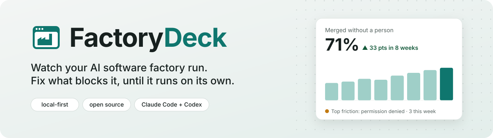
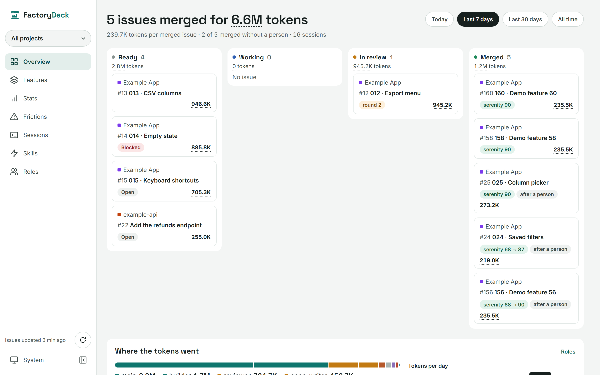
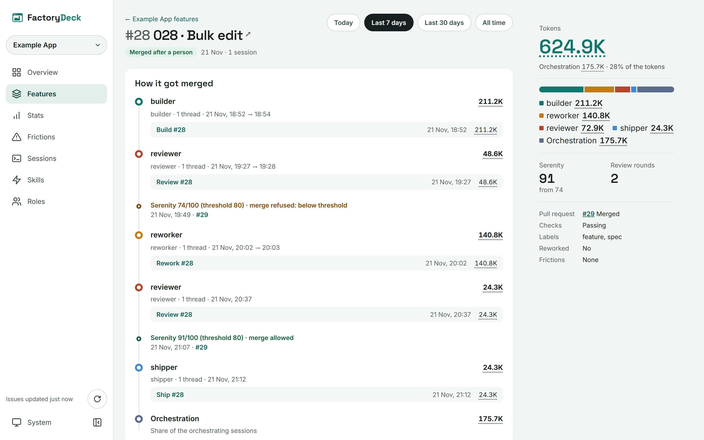
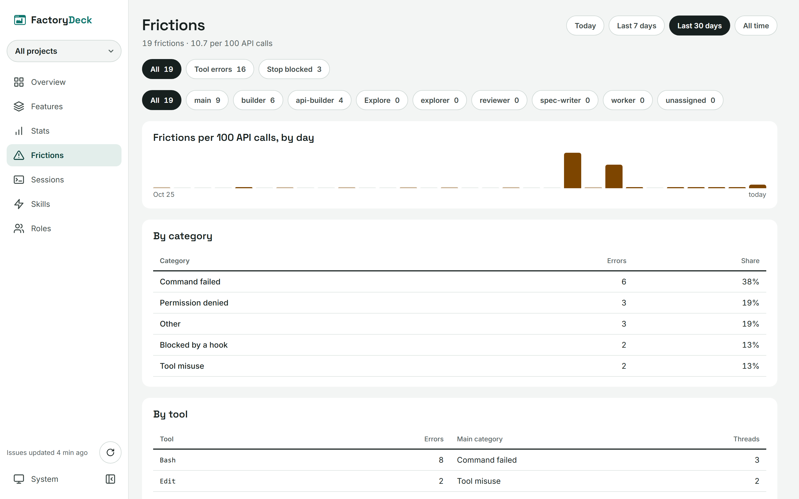
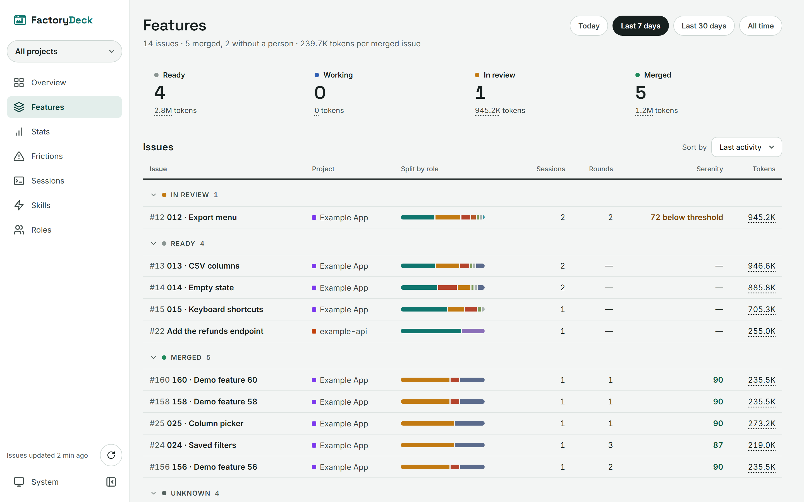

  <picture>
    <source media="(prefers-color-scheme: dark)" srcset="docs/assets/banner-dark.svg" />
    
  </picture>

  
  
  
  

  <a href="#what-you-get">What you get</a> ·
  <a href="docs/getting-started.md">Getting started</a> ·
  <a href="docs/how-it-works.md">How it works</a> ·
  <a href="CONTRIBUTING.md">Contributing</a>

<picture>
  <source media="(prefers-color-scheme: dark)" srcset="docs/assets/loop-dark.svg" />
  
</picture>

FactoryDeck is the dashboard of [**factorydeck-skills**](https://github.com/CGSeb/factorydeck-skills), an AI software factory you install in your projects: agent skills that write specs, build features from issues, review them and merge them.

Once the factory runs, **FactoryDeck shows you how it runs**, so you can make it better, retro after retro, until it runs on its own:

- **Follow the flow**: every issue from ready to merged, what is building now, what waits in review and what is blocked.
- **See where it stalls**: where a person had to step in, and why: a spec question, a score below the threshold, failed checks.
- **Find the frictions**: tool errors, permission denials, blocked stops and failed commands, by role, tool and day.
- **Measure the progress**: the share of issues merged without a person, right the first time, review rounds, and what each step costs.

Each turn of the loop should leave fewer issues waiting for a person and fewer frictions per run. FactoryDeck tells you whether it did.

FactoryDeck reads only the projects where the factory is installed, and everything stays on your machine.

## What you get

|                      |                                                                                                               |
| -------------------- | ------------------------------------------------------------------------------------------------------------- |
| 📈 **Stats**         | Autonomy, quality and flow over time: merged without a person, why a person stepped in, right the first time. |
| 🗂️ **Overview**      | The factory at a glance: issues ready, building, in review and merged, with their review round and score.     |
| 🧭 **Issue story**   | How one issue got merged: each agent thread, each review verdict, and the moment a person had to step in.     |
| ⚠️ **Frictions**     | Tool errors, permission denials, blocked stops and failed commands, to fix the ones that come back.           |
| 🧩 **Features**      | Every issue with its sessions, review rounds, score and cost, split by role.                                  |
| 🧵 **Sessions**      | Every session and sub-agent, with its model, its tokens and the issue it worked on.                           |
| ⚡ **Skills, roles** | Which skills and roles your factory launches, how often, and what each one costs.                             |

<table>
  <tr>
    <td width="50%">
      <a href="docs/assets/screenshots/overview-light.png">
        <picture>
          <source media="(prefers-color-scheme: dark)" srcset="docs/assets/screenshots/overview-dark.png" />
          
        </picture>
      </a>
      
<b>Overview</b>: the factory at a glance

    </td>
    <td width="50%">
      <a href="docs/assets/screenshots/issue-light.png">
        <picture>
          <source media="(prefers-color-scheme: dark)" srcset="docs/assets/screenshots/issue-dark.png" />
          
        </picture>
      </a>
      
<b>Issue</b>: how it got merged

    </td>
  </tr>
  <tr>
    <td width="50%">
      <a href="docs/assets/screenshots/frictions-light.png">
        <picture>
          <source media="(prefers-color-scheme: dark)" srcset="docs/assets/screenshots/frictions-dark.png" />
          
        </picture>
      </a>
      
<b>Frictions</b>: what slows your agents down

    </td>
    <td width="50%">
      <a href="docs/assets/screenshots/features-light.png">
        <picture>
          <source media="(prefers-color-scheme: dark)" srcset="docs/assets/screenshots/features-dark.png" />
          
        </picture>
      </a>
      
<b>Features</b>: every issue, its rounds and its cost

    </td>
  </tr>
</table>

Screenshots show the synthetic data of <code>pnpm demo</code>. Click one to see it full size.

## Get started

1. Install the factory in your projects: follow the [factorydeck-skills install steps](https://github.com/CGSeb/factorydeck-skills#install), then run `/setup-factory`.
2. Run FactoryDeck from source: see [Getting started](docs/getting-started.md) for the setup and the configuration.

> [!NOTE]
> FactoryDeck is in early development. There is no release yet. Want to look around first? `pnpm demo` serves synthetic data.

## Contributing

Development setup, checks and conventions are in [CONTRIBUTING.md](CONTRIBUTING.md). Feature specs live in [`docs/specs`](docs/specs).

## License

[MIT](LICENSE)
