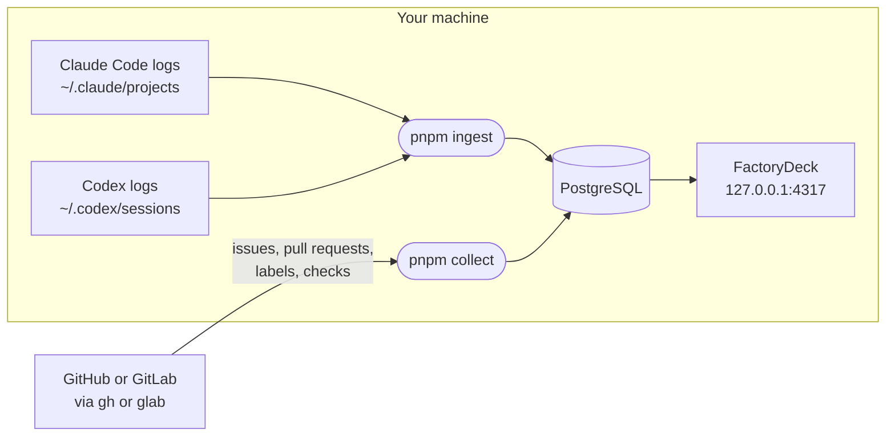
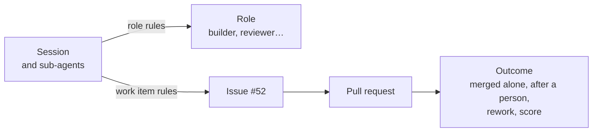

# How FactoryDeck works

1. **Ingest** reads the Claude Code and Codex session logs, sub-agents included, into a local PostgreSQL database. A second run only reads what is new.
2. **Collect** reads issues, pull or merge requests, labels and checks from each project's git host, through the `gh` or `glab` CLI. FactoryDeck only reads the git host, it never writes to it.
3. **Link** matches each session to a role and a work item, then each work item to its outcome, so every run, error and intervention lands on the issue it belongs to:

Sessions that match no rule still count, under an **unassigned** role, so the totals are always complete.

## What is stored

Figures and labels, not conversations: token counts, models and times, session titles, sub-agent descriptions, branches, the skills and slash commands launched, the closing line of each turn, and for each friction its kind, tool, category, program, exit code, a hash of its command and the command of a refusing hook. No prompt, tool output, command text, error message or file content is stored. Opening a row of the Frictions page to read its latest occurrences reads their commands and error messages from the session logs on this computer, and opening the full output of one occurrence reads that output again; each is read for that request only: they are never written to the database, a cache, a file or FactoryDeck's own output.

## Only factory projects

FactoryDeck only reads the sessions of projects where the factory is installed, that is with a `docs/agents/factory.yml` file at their root. Your other sessions are skipped.

> [!TIP]
> FactoryDeck is the dashboard of [**factorydeck-skills**](https://github.com/CGSeb/factorydeck-skills), the factory itself: a plugin of agent skills that write specs, build features from issues, review them and merge them. Follow its [install steps](https://github.com/CGSeb/factorydeck-skills#install), then run `/setup-factory` in your project: its earlier sessions are read at the next ingestion.

A project shows under the `project.name` of its `docs/agents/factory.yml`, or under its folder name when it has none. The project select of the sidebar shows one project, or all of them, on every page; the choice lives in the `project` URL parameter, so a link or a reload keeps it.

To install and configure FactoryDeck, see [Getting started](getting-started.md).
